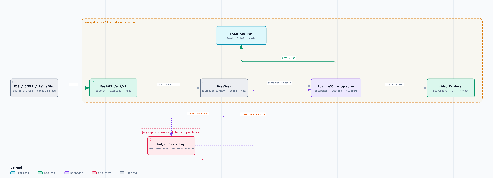
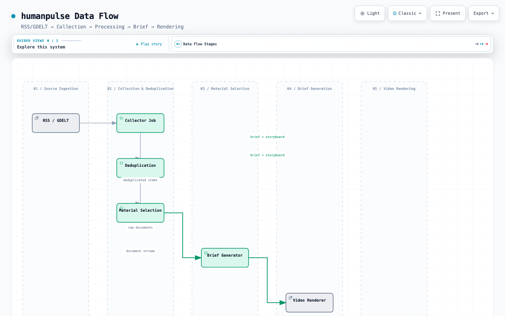
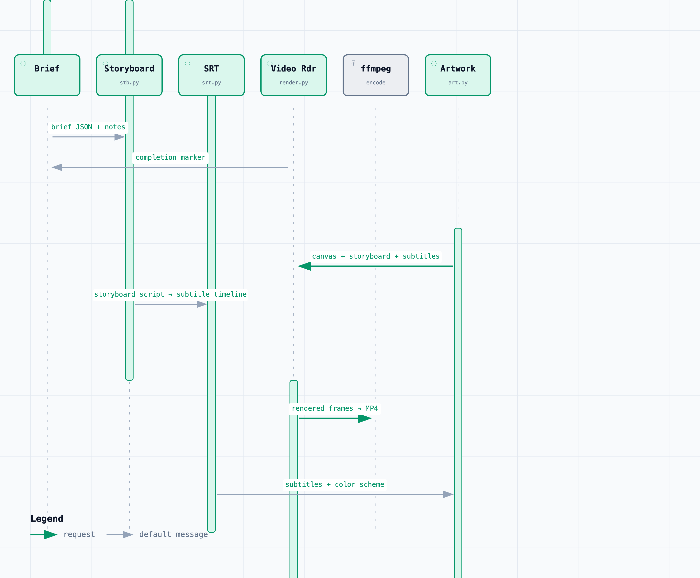

[简体中文](README.md) | English

# humanpulse

> A tracking platform for observing human conflict, science & technology development, and global social movements: multi-source ingestion → dedup → AI bilingual summarization & scoring → clustering → daily/weekly briefs → web reading.

Current status: **Phases 1–2 complete, Phase 3 mostly done**. 33 sources (12 in Chinese) → ~430 items ingested per run →
bilingual summaries & scores → semantic vector clustering → daily/weekly briefs → entity timelines → video briefs → semantic search → PWA.
The full pipeline has run end to end on real data; remaining: TTS voiceover, automated entity alias resolution, VPS deployment.

- Data source policy: [docs/adr/0002-data-source-policy.md](docs/adr/0002-data-source-policy.md)
- Architecture decisions: [docs/adr/](docs/adr/)
- Operations runbook: [docs/runbook.md](docs/runbook.md)
- Contributing & ingestion rules: [docs/contributing.md](docs/contributing.md)

## Architecture







- The backend is the single source of truth; every client shares one REST contract and the types generated into `packages/api-client`.
- Storage: PostgreSQL + pgvector (documents, vectors and clusters in one database).
- Every pipeline step is idempotent and re-runnable: `documents.status` walks `pending → enriched / rejected / deduped / failed`.
- Deployment: single VPS + docker compose + Caddy ([ADR-0004](docs/adr/0004-deployment.md)).

## Judge models & projection (Jev / Laya)

The differentiator of this project is not restating the news but **projecting the downstream impact of events**. This is provided by a
"judge" model that runs in parallel with the LLM and **generates no text** — it only answers typed questions (Choice / Score / Noul).

**Key finding: probabilities are not publishable yet.** In testing, Laya zero-shot scored a Brier skill of **-1.69** with ECE **0.36**
on objective sub-questions (thresholds: skill >0.05 / ECE <0.15). Platt calibration brought ECE down to 0.07, but the fitted slope was
only 0.0199 — the calibrator almost entirely ignores the model's input. Therefore `projection_enabled` stays `false`, and every
projection is force-labeled **uncalibrated**.

**Classification** works: entity alignment against a hand-curated alias table (threshold tuned on a calibration set, reported on a
locked test set) is already used for entity alias adjudication. By provider: cloud Jev AUC **1.000** / F1 **1.000**;
local Laya (the fallback once the cloud key expires) AUC **0.799** / F1 **0.882**.

```bash
make laya-model        # download Laya multilingual weights (~660MB)
make laya-serve        # start the local judge service (Jev-compatible routes, 127.0.0.1:8077)

make eval-judgement    # probability quality gate (exits non-zero when the gate fails)
make tune-judgement    # wording comparison + Platt calibration (fit on calibration set, report on locked test set)
make eval-alignment    # entity alignment evaluation (gold standard: hand-curated alias table)
make alias-adjudicate  # adjudicate entity alias candidates with the judge
```

See [ADR-0015](docs/adr/0015-judgement-and-projection.md) for details.

## Quick start

```bash
make doctor        # check local dependencies
make bootstrap     # install dependencies and generate .env (fill in DEEPSEEK_API_KEY / ADMIN_API_KEY)
make dev           # start db + api + worker (docker compose)
make dev-web       # in another terminal: start the frontend at http://localhost:5173
open http://localhost:8000/api/v1/health
```

Backend only, without Docker:

```bash
cd backend && uv sync && uv run uvicorn app.main:app --reload
```

> In restricted sandbox environments, `make` redirects uv / buildx caches to the in-repo `.cache/` (see [docs/contributing.md](docs/contributing.md)).

## Common commands

| Command | What it does |
| --- | --- |
| `make doctor` | check uv / pnpm / node / docker / .env / ports |
| `make bootstrap` | install dependencies and prepare `.env` |
| `make dev` / `make dev-web` | start backend dependencies / frontend dev server |
| `make smoke` | start the stack → migrate → run the pipeline on synthetic data → verify read APIs → tear down (no network) |
| `make lint` / `typecheck` / `test` | run the respective checks |
| `make verify` | **must be all green before pushing**: lint + typecheck + test + build + compose validation |
| `make openapi` | export `backend/openapi.json` (for api-client type generation) |
| `make migrate` | run Alembic migrations (`alembic upgrade head`) |
| `make seed` | write the sources from `infra/seed/sources.yaml` into the database |
| `make demo` | run ingest → process → cluster on synthetic data (`LLM_PROVIDER=fake`, costs nothing) |
| `make collect-once` | trigger one real collection run (stack must be up and `ADMIN_API_KEY` exported) |
| `make brief` | generate a brief (`KIND=daily` default / `KIND=weekly`; `FORCE=1` forces a rerun) |
| `make ml` / `make reembed` | install local embedding dependencies / recompute vectors & clusters after a model change |
| Production image | `docker build --build-arg WITH_ML=1 ./backend` (includes local embeddings, ~4.3GB) |
| `make entities` | backfill historical `analyses.entities` into the entity tables (idempotent) |
| `make aliases` / `make entity-candidates` | apply the entity alias table (中国/China merged) / list candidate pairs that look like the same entity |
| Admin UI `#/admin` → entity candidates | confirm merges in the browser (touches the database only); checked pairs are written back to `backend/app/entity_aliases.yaml` |
| `make video` | generate the video script & subtitles (`BRIEF_ID=` picks an issue, `RENDER=1` renders MP4; needs ffmpeg + `uv sync --extra video`) |
| `make video VOICE=1` | add narration (`TTS_PROVIDER=macos-say` or `command` to hook up piper / cloud TTS, see [ADR-0013](docs/adr/0013-video-tts.md)) |
| Scene visuals | backgrounds are generated programmatically (gradients + arcs + keyword watermarks); **no images from source articles**, see [ADR-0014](docs/adr/0014-scene-artwork.md) |
| Prediction registry | projection nodes are registered as falsifiable predictions, auto-checked at expiry with public calibration (Brier / reliability curves), see [ADR-0015](docs/adr/0015-judgement-and-projection.md) |
| Install to home screen | the production build ships a PWA manifest & service worker (caches the app shell only; API data is never cached, see [ADR-0011](docs/adr/0011-pwa.md)) |
| `make reprice` | recompute historical costs at official pricing (inputs priced as cache misses — an upper bound) |

Switching to the real model: set `LLM_PROVIDER` to `deepseek` (the default) in `.env` and fill in `DEEPSEEK_API_KEY`.
**Production must switch to semantic embeddings**: run `make ml` (= `uv sync --extra ml`), set `EMBEDDING_PROVIDER` to `local`,
then `make reembed` to recompute vectors and clusters.
The default `hash` only proves the pipeline runs: on the same batch of 430 real items, `hash` produced 1 multi-document cluster,
while `local` produced 10 (the largest spans 6 items from 6 sources).

## API overview (`/api/v1`)

| Method | Path | Description |
| --- | --- | --- |
| GET | `/health`, `/ready` | liveness / readiness (includes database connectivity) |
| GET | `/documents` | Feed: cursor pagination; filter by `status/lang/kind/tag/region/min_score/cluster_id/since/until/q` |
| GET | `/documents/{id}` | detail: summary, score, tags + other sources covering the same cluster |
| GET | `/clusters`, `/clusters/{id}` | cluster list & detail (multi-source coverage of one event) |
| GET | `/briefs`, `/briefs/latest?kind=daily\|weekly`, `/briefs/{id}` | brief list / latest issue / detail (structured bilingual content & weekly trends) |
| GET | `/entities`, `/entities/{id}` | entity list (sorted by mentions/recency, searchable) / detail with per-day timeline |
| GET | `/search?q=` | semantic search (vector nearest neighbors, similarity-ordered; quality depends on `EMBEDDING_PROVIDER`) |
| GET | `/stream` | Feed realtime event stream (SSE; `event: ready` → `event: document`) |
| GET | `/briefs/{id}/markdown?language=zh\|en` | re-render Markdown in one language (no model calls) |
| GET | `/sources` | data source list |
| PATCH | `/sources/{id}` | enable/disable, adjust collection frequency (needs `X-API-Key`) |
| POST | `/uploads`, `/uploads/text` | manual file upload / pasted text (needs `X-API-Key`; ingestion rights must be confirmed) |
| POST | `/admin/jobs/{collect,process,brief}/run` | manually trigger collect/process/brief (brief supports `kind=daily\|weekly`; needs `X-API-Key`) |
| GET | `/admin/runs`, `/admin/usage` | collection batch records / LLM usage & cost (needs `X-API-Key`) |
| POST | `/takedown` | submit a content removal/blocking request |

Interactive docs: `http://localhost:8000/docs`.

## Repository layout

```
backend/           FastAPI + SQLAlchemy + Alembic + collectors + pipeline
web/               React 19 + Vite + Tailwind v4 + TanStack Query
packages/api-client/     shared TS API client (types generated from OpenAPI)
packages/design-tokens/  shared design variables
infra/seed/        initial source list
docs/              ADRs, data source policy, runbook
scripts/           doctor / smoke / deploy / restore-drill
```

## Data & compliance

- Only public content is collected; robots.txt, site ToS and API quotas are respected; every record keeps its source link and fetch time.
- By default only metadata + short quotes + summaries are stored; **full text is never served** (`STORE_FULLTEXT=false`).
- Removal requests: `POST /api/v1/takedown`; entity records involving individuals have a deletion path.
- **No** X (Twitter) scraping and **no** bypassing Cloudflare or similar protections; sources that block us are dropped (see [docs/data-sources.md](docs/data-sources.md)).
- All AI-generated content is labeled; the platform takes no editorial stance.
- Daily/weekly briefs: deduplicated by event from screened records, Top N; structured JSON in the database, Markdown rendered server-side (see [ADR-0006](docs/adr/0006-daily-briefs.md)).
- Cost: unit prices from the [official DeepSeek pricing page](https://api-docs.deepseek.com/quick_start/pricing/), priced per model and cache hit/miss, doubled at peak hours (see `backend/app/llm/pricing.py`).
- Entities: LLM-extracted entities land in `entities`/`entity_mentions` with per-day timelines ([ADR-0007](docs/adr/0007-entity-timeline.md));
- Video briefs: brief → storyboard script → SRT subtitles (deterministic, no model calls) → programmatic scene visuals → MP4, optional TTS voiceover; see [ADR-0010](docs/adr/0010-video-brief.md), [ADR-0013](docs/adr/0013-video-tts.md), [ADR-0014](docs/adr/0014-scene-artwork.md).
  Cross-language spellings merge into one entity via a human-curated alias table (`backend/app/entity_aliases.yaml`, [ADR-0009](docs/adr/0009-entity-alias-merge.md)).
- Content quality guardrail: items published earlier than `MAX_ITEM_AGE_DAYS` (default 45 days) are marked `rejected/too_old`; headline-only items (e.g. GDELT) use a headline prompt, and their summaries must be labeled "based on the headline only" with a `headline-only` tag.

## Disclaimer

This project is an information aggregation and observation tool. Aggregated content comes from third-party public sources and belongs to the original authors; summaries are generated by large language models and may contain errors — always refer to the original source. The platform expresses no editorial position and endorses no facts.

## Roadmap

| Phase | Scope | Status |
| --- | --- | --- |
| Phase 0 | skeleton, CI, compose, ADRs, GitHub repository | complete |
| Phase 1 | data model, RSS/GDELT/manual upload, SimHash + DeepSeek summaries + vector dedup & clustering, read APIs, web Feed & detail | complete |
| Phase 2 | daily/weekly briefs, admin UI, more sources, SSE, VPS launch | complete (VPS deployment pending registration) |
| Phase 3 | video briefs, mobile, entity timelines, semantic search, deep-dive agent | in progress (entity timeline + alias merging done; video/mobile pending) |
