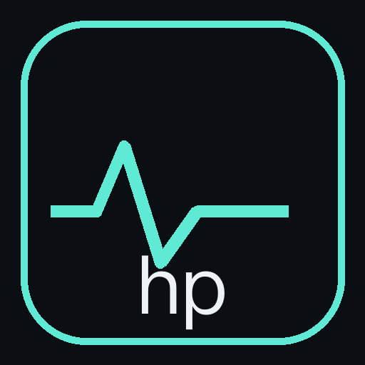

# humanpulse

> 一个观察人类冲突、科学技术发展与全球社会运动的追踪平台：多源采集 → 去重 → AI 双语摘要与评分 → 聚类 → 日报/周报 → Web 阅读。

当前状态：**Phase 1–2 完成，Phase 3 大部分完成**。33 个源（中文 12）→ 单轮约 430 条入库 →
双语摘要与评分 → 语义向量聚类 → 日报/周报 → 实体时间线 → 视频简报 → 语义搜索 → PWA。
全链路已用真实数据跑通；剩余：TTS 配音、实体别名自动化、VPS 部署。

- 数据源政策：[docs/adr/0002-data-source-policy.md](docs/adr/0002-data-source-policy.md)
- 架构决策：[docs/adr/](docs/adr/)
- 运维手册：[docs/runbook.md](docs/runbook.md)
- 贡献与上传规则：[docs/contributing.md](docs/contributing.md)

## 架构

```
采集层           处理层                        服务/展示层
RSS/GDELT/       normalize → SimHash 去重 →     FastAPI (/api/v1)
ReliefWeb/       DeepSeek 双语摘要+评分+标签 →   ├─ Web (React + Vite)
手动上传         向量去重/聚类 → 日报/周报        └─ 后续：Tauri 桌面 / Expo 移动
```

- 后端是唯一数据源；所有客户端复用同一份 REST 契约与 `packages/api-client` 生成的类型。
- 存储：PostgreSQL + pgvector（文章、向量、聚类同库）。
- 处理流水线每一步幂等可重跑：`documents.status` 走 `pending → enriched / rejected / deduped / failed`。
- 部署：单台 VPS + docker compose + Caddy（[ADR-0004](docs/adr/0004-deployment.md)）。

## 快速开始

```bash
make doctor        # 检查本机依赖
make bootstrap     # 安装依赖并生成 .env（需填入 DEEPSEEK_API_KEY / ADMIN_API_KEY）
make dev           # 起 db + api + worker（docker compose）
make dev-web       # 另开终端：起前端 http://localhost:5173
open http://localhost:8000/api/v1/health
```

不用 Docker 也可以只跑后端：

```bash
cd backend && uv sync && uv run uvicorn app.main:app --reload
```

> 受限沙箱环境下，`make` 会把 uv / buildx 缓存重定向到仓库内 `.cache/`（说明见 [docs/contributing.md](docs/contributing.md)）。

## 常用命令

| 命令 | 说明 |
| --- | --- |
| `make doctor` | 检查 uv / pnpm / node / docker / .env / 端口 |
| `make bootstrap` | 安装依赖并准备 `.env` |
| `make dev` / `make dev-web` | 起后端依赖服务 / 前端开发服务器 |
| `make smoke` | 起栈 → 迁移 → 合成数据跑通流水线 → 校验读取接口 → 收栈（不联网） |
| `make lint` / `typecheck` / `test` | 分别运行检查 |
| `make verify` | **上传前必须全绿**：lint + typecheck + test + build + compose 校验 |
| `make openapi` | 导出 `backend/openapi.json`（供 api-client 生成类型） |
| `make migrate` | 执行 Alembic 迁移（`alembic upgrade head`） |
| `make seed` | 把 `infra/seed/sources.yaml` 的源写入数据库 |
| `make demo` | 用合成数据跑通采集→处理→聚类（`LLM_PROVIDER=fake`、不花钱） |
| `make collect-once` | 手动触发一次真实采集（需栈已起并导出 `ADMIN_API_KEY`） |
| `make brief` | 生成简报（`KIND=daily` 默认 / `KIND=weekly`；`FORCE=1` 强制重跑） |
| `make ml` / `make reembed` | 安装本地语义向量依赖 / 换模型后重算向量与聚类 |
| 生产镜像 | `docker build --build-arg WITH_ML=1 ./backend`（含 local 向量，约 4.3GB） |
| `make entities` | 把历史 `analyses.entities` 回填进实体表（幂等） |
| `make aliases` / `make entity-candidates` | 应用实体别名表（中国/China 合并）/ 列出疑似同实体的候选对 |
| 管理台 `#/admin` → 实体候选 | 网页确认合并（只改数据库）；勾选后才写回 `backend/app/entity_aliases.yaml` |
| `make video` | 生成视频脚本与字幕（`BRIEF_ID=` 指定某期，`RENDER=1` 出 MP4，需 ffmpeg + `uv sync --extra video`） |
| `make video VOICE=1` | 加旁白配音（`TTS_PROVIDER=macos-say` 或 `command` 接 piper/云 TTS，见 [ADR-0013](docs/adr/0013-video-tts.md)） |
| 分镜视觉 | 程序化生成背景（渐变 + 圆弧 + 关键词水印），**不使用原文配图**，见 [ADR-0014](docs/adr/0014-scene-artwork.md) |
| 安装到主屏 | 生产构建带 PWA 清单与 Service Worker（只缓存外壳，接口数据不缓存，见 [ADR-0011](docs/adr/0011-pwa.md)） |
| `make reprice` | 按官方定价重算历史成本（输入按未命中计，属上界） |

切到真实模型：在 `.env` 里把 `LLM_PROVIDER` 设为 `deepseek`（默认）并填好 `DEEPSEEK_API_KEY`；
**生产必须切换到语义向量**：执行 `make ml`（= `uv sync --extra ml`）并把 `EMBEDDING_PROVIDER` 改成 `local`，再用 `make reembed` 重算向量与聚类。
默认的 `hash` 只保证链路跑通：同一批 430 条真实数据下，`hash` 只聚出 1 个多文档聚类，`local` 聚出 10 个（最大 6 条来自 6 个源）。

## API 一览（`/api/v1`）

| 方法 | 路径 | 说明 |
| --- | --- | --- |
| GET | `/health`、`/ready` | 存活 / 就绪（含数据库连通性） |
| GET | `/documents` | Feed：游标分页，可按 `status/lang/kind/tag/region/min_score/cluster_id/since/until/q` 过滤 |
| GET | `/documents/{id}` | 详情：摘要、评分、标签 + 同一 cluster 的其它来源报道 |
| GET | `/clusters`、`/clusters/{id}` | 聚类列表与详情（同一事件的多来源覆盖） |
| GET | `/briefs`、`/briefs/latest?kind=daily\|weekly`、`/briefs/{id}` | 简报列表 / 最新一期 / 详情（含结构化双语内容与周报趋势） |
| GET | `/entities`、`/entities/{id}` | 实体列表（按提及/最近排序，可搜索）/ 实体详情与按天时间线 |
| GET | `/search?q=` | 语义搜索（向量近邻，按相似度排序；质量取决于 EMBEDDING_PROVIDER） |
| GET | `/stream` | Feed 实时事件流（SSE；`event: ready` → `event: document`） |
| GET | `/briefs/{id}/markdown?language=zh\|en` | 按语言重渲染 Markdown（不调用模型） |
| GET | `/sources` | 数据源列表 |
| PATCH | `/sources/{id}` | 启用/停用、调整采集频率（需 `X-API-Key`） |
| POST | `/uploads`、`/uploads/text` | 手动上传文件 / 粘贴文本（需 `X-API-Key`，须确认收录权利） |
| POST | `/admin/jobs/{collect,process,brief}/run` | 手动触发采集/处理/简报（brief 支持 `kind=daily\|weekly`；需 `X-API-Key`） |
| GET | `/admin/runs`、`/admin/usage` | 采集批次记录 / LLM 用量与成本（需 `X-API-Key`） |
| POST | `/takedown` | 提交内容删除/屏蔽申请 |

交互式文档：`http://localhost:8000/docs`。

## 目录结构

```
backend/           FastAPI + SQLAlchemy + Alembic + 采集器 + 流水线
web/               React 19 + Vite + Tailwind v4 + TanStack Query
packages/api-client/     共享 TS API 客户端（类型由 OpenAPI 生成）
packages/design-tokens/  共享设计变量
infra/seed/        初始数据源清单
docs/              ADR、数据源政策、runbook
scripts/           doctor / smoke / deploy / restore-drill
```

## 数据与合规

- 只采集公开内容；遵守 robots.txt、站点 ToS 与各 API 配额；每条记录保留来源链接与抓取时间。
- 默认只存元数据 + 短引用 + 摘要，**不对外提供全文**（`STORE_FULLTEXT=false`）。
- 提交删除申请：`POST /api/v1/takedown`；涉及个人的实体记录提供删除路径。
- **不使用** X（Twitter）抓取、**不绕过** Cloudflare 等防护；被防护拦下的源直接停用（详见 [docs/data-sources.md](docs/data-sources.md)）。
- AI 生成内容一律标注，平台不做立场性结论。
- 日报/周报：由已筛选记录按事件去重后取 Top N 生成，结构化 JSON 入库、Markdown 由服务端渲染（见 [ADR-0006](docs/adr/0006-daily-briefs.md)）。
- 成本：单价取自 [DeepSeek 官方定价页](https://api-docs.deepseek.com/quick_start/pricing/)，按模型与缓存命中/未命中分别计价，高峰时段自动翻倍（见 `backend/app/llm/pricing.py`）。
- 实体：LLM 输出的实体写入 `entities`/`entity_mentions`，支持按天时间线（[ADR-0007](docs/adr/0007-entity-timeline.md)）；
- 视频简报：简报 → 分镜脚本 → SRT 字幕（确定性、不调模型）→ 程序化分镜视觉 → MP4，可选 TTS 配音；见 [ADR-0010](docs/adr/0010-video-brief.md)、[ADR-0013](docs/adr/0013-video-tts.md)、[ADR-0014](docs/adr/0014-scene-artwork.md)。
  跨语言写法由人工别名表合并成一条（`backend/app/entity_aliases.yaml`，[ADR-0009](docs/adr/0009-entity-alias-merge.md)）。
- 内容质量兜底：发布早于 `MAX_ITEM_AGE_DAYS`（默认 45 天）的条目记 `rejected/too_old`；只有标题可用的条目（如 GDELT）走 headline 提示词，摘要必须标注"仅据标题"并打 `headline-only` 标签。

## 免责声明

本项目是信息聚合与观察工具，聚合内容来自第三方公开来源，版权归原作者所有；摘要由大模型生成，可能存在错误，请以原文为准。平台不构成任何形式的立场表达或事实背书。

## 路线图

| 阶段 | 内容 | 状态 |
| --- | --- | --- |
| Phase 0 | 骨架、CI、compose、ADR、GitHub 仓库 | 已完成 |
| Phase 1 | 数据模型、RSS/GDELT/手动上传、SimHash + DeepSeek 摘要 + 向量去重与聚类、读取接口、Web Feed 与详情 | 已完成 |
| Phase 2 | 日报/周报、管理台、更多源、SSE、VPS 上线 | 已完成（VPS 待注册后部署） |
| Phase 3 | 视频简报、移动端、实体时间线、语义搜索、深度调查 agent | 进行中（实体时间线 + 别名合并已完成；视频/移动端待做） |
| Phase 3 | 视频简报、移动端、实体时间线、语义搜索、深度调查 agent | 待开始 |
